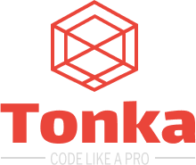

# TONKA, UN VÉRITABLE FRAMEWORK PHP

> Léger, productif et sécurisé.

**Tonka** est un framework PHP reposant sur l'architecture MVC (Modèle-Vue-Contrôleur). Conçu pour allier légèreté et performance, il fournit un ensemble complet de fonctionnalités qui simplifient le développement et accélèrent la livraison de vos applications.

[Dépôt GitHub](https://github.com/clicalmani/Tonka) · [Prise en main](./introduction.md)
