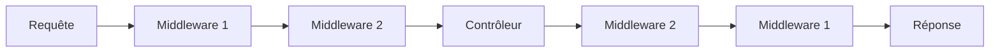

# Middlewares

- [Middlewares](#middlewares)
- [Qu'est-ce qu'un Middleware ?](#qu-39-est-ce-qu-39-un-middleware-)
- [Création d'un Middleware](#creation-d-39-un-middleware)
- [Structure d'un Middleware](#structure-d-39-un-middleware)
  - [La Méthode `handle()`](#la-methode-code-handle-code-)
  - [La Méthode `boot()`](#la-methode-code-boot-code-)
  - [Types de Retour](#types-de-retour)
- [Enregistrement des Middlewares](#enregistrement-des-middlewares)
  - [Middlewares Globaux](#middlewares-globaux)
  - [Middlewares de Route](#middlewares-de-route)
- [Application des Middlewares](#application-des-middlewares)
  - [Sur une Route](#sur-une-route)
  - [Sur un Groupe](#sur-un-groupe)
  - [Ordre d'Exécution](#ordre-d-39-execution)
- [Exclusion de Middlewares](#exclusion-de-middlewares)
  - [Sur une Route](#sur-une-route-1)
  - [Via le Trait HasMiddleware](#via-le-trait-hasmiddleware)
- [Middleware avec Paramètres](#middleware-avec-parametres)
- [Middleware et Routes](#middleware-et-routes)
  - [Chargement Automatique](#chargement-automatique)
  - [Structure des Routes](#structure-des-routes)
- [Middleware Terminable](#middleware-terminable)
- [Mode Maintenance](#mode-maintenance)
- [Prochaines Étapes](#prochaines-etapes)

---

## Qu'est-ce qu'un Middleware ?

Un middleware est une couche qui intercepte la requête HTTP avant qu'elle n'atteigne le contrôleur, et qui peut également intervenir sur la réponse avant son envoi au client. Il permet d'isoler des préoccupations transverses (authentification, journalisation, limitation de débit) de la logique métier proprement dite, en les factorisant en dehors des contrôleurs.



**Cas d'usage typiques :**
- ✅ Authentification
- ✅ Autorisation
- ✅ Journalisation (logging)
- ✅ Limitation de débit (rate limiting)
- ✅ CORS
- ✅ Protection CSRF
- ✅ Compression
- ✅ Cache
- ✅ Débogage

---

## Création d'un Middleware

### Commande de Génération

```bash
php tonka make:middleware AuthMiddleware
```

### Structure Générée

```php
namespace App\Http\Middlewares;

use Clicalmani\Core\Http\Middlewares\Middleware;
use Clicalmani\Core\Http\RequestInterface;
use Clicalmani\Core\Http\ResponseInterface;
use Clicalmani\Core\Http\RedirectInterface;

class AuthMiddleware extends Middleware
{
    public function handle(RequestInterface $request, ResponseInterface $response, \Closure $next): ResponseInterface|RedirectInterface
    {
        // Logique du middleware
        return $next($request, $response);
    }

    public function boot(): void
    {
        // Chargement des routes associées
    }
}
```

---

## Structure d'un Middleware

### La Méthode `handle()`

C'est le point d'entrée du middleware, invoqué à chaque requête correspondant à une route à laquelle il est attaché.

```php
public function handle(RequestInterface $request, ResponseInterface $response, \Closure $next): ResponseInterface|RedirectInterface
{
    // 1. Vérification avant le passage au maillon suivant
    if (!auth()->isOnline()) {
        return $response->redirect('/login');
    }

    // 2. Délégation au reste de la chaîne
    $response = $next($request, $response);

    // 3. Traitement après le retour de la chaîne
    $response->header('X-Processed-By', 'Tonka');

    return $response;
}
```

### La Méthode `boot()`

Permet de charger automatiquement un ensemble de routes associées à ce middleware — typiquement, un fichier de routes dédié.

```php
public function boot(): void
{
    // Charge automatiquement les routes du module
    $this->include('auth');
}
```

### Types de Retour

```php
// Poursuite normale de la chaîne
return $next($request, $response);

// Redirection
return $response->redirect('/login');

// Réponse JSON d'erreur
return $response->status(401)->json([
    'error' => 'Unauthenticated'
]);

// Réponse HTTP 403
return $response->forbidden();

// Réponse HTTP 404
return $response->notFound();
```

---

## Enregistrement des Middlewares

### Middlewares Globaux

```php
// app/Http/Kernel.php
class Kernel extends HttpKernel
{
    protected array $middleware = [

        /**
         * Middlewares du groupe Web
         */
        'web' => [
            'auth' => \App\Http\Middlewares\AuthMiddleware::class,
            'logger' => \App\Http\Middlewares\RequestLogger::class,
        ],

        /**
         * Middlewares du groupe API
         */
        'api' => [
            'rate_limit' => \App\Http\Middlewares\RateLimiter::class,
            'auth' => \App\Http\Middlewares\JwtAuthMiddleware::class,
        ]
    ];
}
```

### Middlewares de Route

```php
// Enregistrement d'un middleware pour l'ensemble des routes d'un fichier
Route::middleware('auth');
Route::middleware('throttle:60,1');
```

---

## Application des Middlewares

### Sur une Route

```php
// Middleware unique
Route::get('/profile', [ProfileController::class, 'show'])
    ->middleware('auth');

// Middlewares multiples
Route::get('/admin', [AdminController::class, 'index'])
    ->middleware('auth|admin');

// Avec paramètres
Route::get('/users', [UserController::class, 'index'])
    ->middleware('throttle:60,1'); // 60 requêtes par minute
```

### Sur un Groupe

```php
Route::group(function() {
    Route::get('/dashboard', [DashboardController::class, 'index']);
    Route::get('/profile', [ProfileController::class, 'show']);
    Route::post('/profile', [ProfileController::class, 'update']);
})->middleware('auth');

Route::group(function() {
    Route::get('/admin/users', [UserController::class, 'index']);
    Route::get('/admin/posts', [PostController::class, 'index']);
})->middleware('auth|admin');
```

### Ordre d'Exécution

Les middlewares s'exécutent dans l'ordre où ils sont déclarés dans le tableau `$middleware` :

```php
// Ordre d'exécution :
// 1. AuthMiddleware
// 2. AdminMiddleware
// 3. Contrôleur

protected array $middleware = [
    'web' => [
        'auth' => AuthMiddleware::class,
        'admin' => AdminMiddleware::class,
    ]
];
```

!> **Point d'attention :** l'ordre de déclaration dans le kernel détermine l'ordre d'exécution effectif, même lorsque les alias sont invoqués dans un ordre différent via `->middleware('admin|auth')` sur une route donnée. En cas de doute, alignez toujours l'ordre de vos alias sur celui du kernel pour éviter les surprises.

---

## Exclusion de Middlewares

### Sur une Route
<div id="sur-une-route-1"></div>

```php
// Exclure un middleware global
Route::get('/webhook', [WebhookController::class, 'handle'])
    ->withoutMiddleware('csrf');

// Exclure plusieurs middlewares
Route::get('/public', [PublicController::class, 'index'])
    ->withoutMiddleware(['auth', 'csrf']);
```

L'exclusion est particulièrement utile pour les endpoints qui doivent rester accessibles sans état de session — un webhook entrant, par exemple, ne peut porter ni cookie de session ni jeton CSRF.

### Via le Trait HasMiddleware

```php
use Clicalmani\Core\Traits\HasMiddleware;

class UserController extends Controller
{
    use HasMiddleware;

    public function __construct()
    {
        // Appliquer uniquement à certaines actions
        $this->middleware('auth')->only('index', 'show');

        // Appliquer à toutes les actions sauf celles-ci
        $this->middleware('admin')->except('index', 'show');
    }
}
```

Cette approche centralise l'association middleware/action directement dans le contrôleur, plutôt que dans le fichier de routes — un choix pertinent lorsque la règle d'application dépend fortement de la logique interne du contrôleur plutôt que de la structure des routes.

---

## Middleware avec Paramètres

### Définition

```php
class ThrottleMiddleware extends Middleware
{
    public function __construct(
        private int $limit = 60,
        private int $window = 1
    )
    {}

    public function handle(RequestInterface $request, ResponseInterface $response, \Closure $next): ResponseInterface|RedirectInterface
    {
        $key = $request->ip() . ':' . $request->route()->uri;

        if ($this->isRateLimited($key, $this->limit, $this->window)) {
            return $response->status(429)->json([
                'error' => 'Too many requests',
                'retry_after' => $this->window
            ]);
        }

        return $next($request, $response);
    }

    // Logique de limitation (isRateLimited, etc.)
}
```

### Utilisation

```php
// Sur l'ensemble d'un fichier de routes
Route::middleware('throttle:60,1');

// Sur une route
Route::get('/users', [UserController::class, 'index'])
    ->middleware('throttle:60,1');

// Sur un groupe de routes
Route::controller(UserController::class)->group(function() {
    Route::get('/', 'index');
})->middleware('throttle:60,1')->prefix('users');
```

---

## Middleware et Routes

### Chargement Automatique

```php
class AuthMiddleware extends Middleware
{
    public function boot(): void
    {
        // Charge automatiquement les routes protégées
        $this->include('auth');
    }
}
```

### Structure des Routes

```php
// routes/web.php
Route::get('/login', [AuthController::class, 'login'])->name('login');
Route::post('/login', [AuthController::class, 'authenticate']);
Route::get('/register', [AuthController::class, 'register']);
Route::post('/register', [AuthController::class, 'store']);
Route::get('/logout', [AuthController::class, 'logout'])->name('logout');

Route::middleware('auth');

Route::get('/dashboard', fn() => view('dashboard'))->name('dashboard');
```

Les routes déclarées **avant** l'appel `Route::middleware('auth')` ne sont pas concernées par ce middleware. À l'inverse, la route nommée `dashboard`, déclarée après cet appel, hérite du middleware `auth` — au même titre que toutes les routes définies dans le fichier de routes propre au middleware (chargé via `boot()`/`include()`).

```php
// routes/auth.php
Route::get('/profile', fn() => view('profile'))->name('profile');

// Middlewares associés :
// dashboard ⇾ auth
// profile   ⇾ auth
```

En ajoutant un second appel `Route::middleware()` en tête du fichier de routes inclus, les routes qui suivent cumulent les deux middlewares :

```php
// routes/auth.php
Route::middleware('logger');

Route::get('/profile', fn() => view('profile'))->name('profile');

// Middlewares associés :
// dashboard ⇾ auth
// profile   ⇾ auth, logger
```

---

## Middleware Terminable

Un middleware terminable expose une méthode `terminate()`, exécutée **après** l'envoi de la réponse au client. C'est l'emplacement approprié pour tout traitement qui ne doit pas retarder la réponse perçue par l'utilisateur — journalisation détaillée, envoi de métriques, nettoyage différé.

```php
class LogMiddleware extends Middleware
{
    public function handle(RequestInterface $request, ResponseInterface $response, \Closure $next): ResponseInterface|RedirectInterface
    {
        return $next($request, $response);
    }

    public function terminate(RequestInterface $request, ResponseInterface $response): void
    {
        // Exécuté après l'envoi de la réponse
        logger()->info('Request completed', [
            'method' => $request->getMethod(),
            'uri' => $request->getUri(),
            'status' => $response->getStatusCode()
        ]);
    }
}
```

> **Pour les développeurs Symfony :** `terminate()` joue un rôle comparable à l'événement `kernel.terminate` — du code exécuté après la réponse envoyée, sans faire attendre le client.

---

## Mode Maintenance

Contrairement à d'autres préoccupations transverses (authentification, CORS, rate limiting), le mode maintenance n'est **pas** géré par un middleware dans Tonka, mais par un service dédié du routeur (`RouteService`).

La raison est d'ordre technique : une redirection déclenchée à ce stade précoce du cycle de vie n'amorce pas complètement l'application — l'objet requête n'est alors pas encore disponible (il vaut `null`), ce qui exclut de facto tout traitement par middleware, puisqu'un middleware requiert un objet requête pour fonctionner. Passer par ce service de route offre en contrepartie deux avantages : la possibilité d'exploiter les paramètres optionnels de la route pour court-circuiter la redirection selon le contexte, et celle d'ajouter des en-têtes supplémentaires via la propriété `response` héritée, en modifiant la réponse juste après l'appel à `redirectTo()`.

```php
namespace App\Auth;

use Clicalmani\Core\Http\Redirectable;
use Clicalmani\Core\Providers\RouteService;

/**
 * Service de redirection de route
 */
class MaintenanceRedirect extends RouteService implements Redirectable
{
    /**
     * Constructeur
     *
     * @param \Clicalmani\Routing\Route|false $route
     */
    public function __construct(protected \Clicalmani\Routing\Route|false $route)
    {
        parent::__construct();
    }

    public function redirect(): void
    {
        if ($this->route) {
            $routeName = 'maintenance'; // Nom de la route vers laquelle rediriger

            // Vérifie qu'il ne s'agit pas déjà de la page de maintenance,
            // afin d'éviter une redirection en boucle.
            if (!$this->route->named($routeName)) {
                $this->redirectTo($routeName, 503);
            }
        }
    }
}
```

!> **Point d'attention :** le contrôle `!$this->route->named($routeName)` est ce qui empêche la boucle de redirection infinie — sans lui, la route `maintenance` elle-même serait redirigée vers... elle-même. Ne l'omettez pas si vous adaptez cet exemple.

---

## Prochaines Étapes

Maintenant que vous maîtrisez les middlewares :

1. **[Vues](views.md)** → Créer l'interface utilisateur
2. **[Validation](validation.md)** → Valider les données
3. **[Base de Données](database.md)** → Travailler avec les modèles
4. **[Sécurité](authentication.md)** → Approfondir l'authentification

---

**Middlewares maîtrisés !** 🚀 → [Vues](views.md)