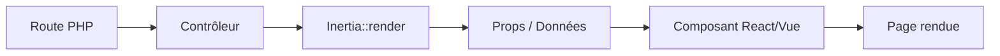

# Vues (Inertia)

Tonka s'intègre nativement avec Inertia.js pour construire des interfaces modernes en React ou Vue, sans jamais avoir à exposer une API REST dédiée au front-end. Cette page couvre l'installation, la configuration et l'usage courant de cette intégration.

- [Vues (Inertia)](#vues-inertia-)
- [Qu'est-ce qu'Inertia.js ?](#qu-39-est-ce-qu-39-inertia-js-)
  - [Avantages](#avantages)
  - [Comment ça fonctionne ?](#comment-ca-fonctionne-)
- [Installation](#installation)
  - [Dépendances PHP](#dependances-php)
  - [Dépendances JavaScript](#dependances-javascript)
- [Configuration](#configuration)
  - [Template Racine](#template-racine)
  - [Vite Configuration](#vite-configuration)
  - [Point d'Entrée Frontend](#point-d-39-entree-frontend)
- [Rendu d'une Page](#rendu-d-39-une-page)
  - [Depuis un Contrôleur](#depuis-un-controleur)
  - [Avec des Données](#avec-des-donnees)
- [Partage de Données](#partage-de-donnees)
  - [Partage Global](#partage-global)
  - [Partage via la Réponse](#partage-via-la-reponse)
- [Composants React/Vue](#composants-react-vue)
  - [Composant React](#composant-react)
  - [Composant Vue](#composant-vue)
- [Gestion des Erreurs](#gestion-des-erreurs)
  - [Validation et Erreurs](#validation-et-erreurs)
  - [Affichage des Erreurs (React)](#affichage-des-erreurs-react)
- [Redirection Inertia](#redirection-inertia)
  - [Redirection Simple](#redirection-simple)
  - [Redirection Interne](#redirection-interne)
- [Version et Cache](#version-et-cache)
  - [Définir la Version](#definir-la-version)
  - [Vérification de Version](#verification-de-version)
- [Exemple Complet](#exemple-complet)
- [Astro (React Starter Kit)](#astro-react-starter-kit-)
- [Comet (Vue Starter Kit)](#comet-vue-starter-kit-)
- [Prochaines Étapes](#prochaines-etapes)

---

## Qu'est-ce qu'Inertia.js ?

Inertia.js est une bibliothèque qui permet de construire une application monopage (SPA) en s'appuyant sur le routage et les contrôleurs **côté serveur**, plutôt que sur un routeur front-end séparé ou une API REST dédiée. Le contrôleur reste responsable de déterminer *quelle* page afficher et *avec quelles données* ; Inertia se charge uniquement du transport de ces données vers le composant React ou Vue correspondant, et de l'orchestration de la navigation sans rechargement complet du navigateur.

En pratique, cela signifie que vous continuez à écrire des routes et des contrôleurs Tonka classiques (voir [Routing](routing.md#routing) et [Contrôleurs](controllers.md#controleurs)) — Inertia ne remplace ni l'un ni l'autre, il élimine simplement la couche d'API intermédiaire habituellement nécessaire entre un backend et une SPA.

### Avantages

- ✅ **Pas d'API dédiée** : pas besoin de construire une API REST séparée pour le front-end
- ✅ **Pas de routage front-end** : les routes restent définies côté backend, dans `routes/`
- ✅ **Navigation type SPA** : transitions fluides entre pages, sans rechargement complet
- ✅ **État transmis directement** : les données sont passées en props au composant, sans sérialisation JSON intermédiaire à gérer manuellement
- ✅ **Performance** : découpage du code (*code splitting*) et chargement différé (*lazy loading*) pris en charge nativement par l'outillage front-end (Vite)

### Comment ça fonctionne ?



---

## Installation

### Dépendances PHP

```bash
composer require inertiajs/tonka-adapter
```

### Dépendances JavaScript

```bash
# React
npm install @inertiajs/react react react-dom

# Vue
npm install @inertiajs/vue3 vue
```

```bash
# Plugin Tonka pour Vite (obligatoire dans les deux cas)
npm install tonka-vite-plugin
```

---

## Configuration

### Template Racine

```twig
{# resources/views/app.twig #}
<!DOCTYPE html>
<html>
<head>
    <meta charset="UTF-8">
    <meta name="viewport" content="width=device-width, initial-scale=1.0">
    @reactRefresh
    @vite('resources/css/app.css', 'resources/js/app.tsx')
    @inertiaHead
</head>
<body>
    @routes
    @inertia
</body>
</html>
```

Ce template racine (le seul rendu directement par Twig) sert de point d'ancrage à l'application Inertia : la directive `@inertia` insère le conteneur DOM que le JavaScript ira monter, et `@inertiaHead` réserve l'emplacement où Inertia injectera dynamiquement le titre et les balises meta définis côté composant.

### Vite Configuration

```typescript
// vite.config.ts
import { defineConfig } from 'vite';
import react from '@vitejs/plugin-react';
import tonka from 'tonka-vite-plugin';
import path from 'node:path';
import { fileURLToPath } from 'node:url'

const __dirname = path.dirname(fileURLToPath(import.meta.url));

// https://vite.dev/config/
export default defineConfig({
    plugins: [
        tonka({
            input: 'resources/js/app.tsx',
            // SSR (Server-Side Rendering)
            ssr: false,
            // HMR : Hot Module Replacement
            refresh: false,
        }),
        react(),
    ],
    define: {
        'process.env': {
            NODE_ENV: JSON.stringify(process.env.NODE_ENV || 'development'),
        },
    }
});
```

### Point d'Entrée Frontend

```typescript
// resources/js/app.tsx
import React, { StrictMode } from 'react';
import ReactDOM, { Container } from 'react-dom/client';
import { createInertiaApp } from '@inertiajs/react';
import { resolvePageComponent } from 'tonka-vite-plugin/helpers';

const appName = import.meta.env.VITE_APP_NAME || 'Tonka';

createInertiaApp({
  title: (title) => (title ? `${title} - ${appName}` : appName),
  resolve: name => resolvePageComponent(
        `./pages/${name}.tsx`,
        import.meta.glob('./pages/**/*.tsx', { eager: true })
  ),
  setup({ el, App, props }) {
    ReactDOM.createRoot(el as Container)
        .render(
          <StrictMode>
            <App {...props} />
          </StrictMode>
        )
  },
  progress: {
    color: '#F64E60',
  },
})
```

`resolvePageComponent` détermine comment le nom de composant passé à `Inertia::render()` côté PHP (`'User.Index'`, par exemple) est traduit en chemin de fichier front-end (`./pages/User/Index.tsx`) — assurez-vous que l'arborescence de `resources/js/pages/` reflète exactement les noms utilisés dans vos contrôleurs.

---

## Rendu d'une Page

### Depuis un Contrôleur

```php
use Inertia\Inertia;

class UserController extends Controller
{
    public function index()
    {
        return Inertia::render('User.Index');
    }
}
```

### Avec des Données

```php
class UserController extends Controller
{
    public function show($id)
    {
        $user = User::with('posts')->find($id);

        return Inertia::render('User.Show', [
            'user' => [
                'id' => $user->id,
                'name' => $user->name,
                'email' => $user->email,
                'posts' => $user->posts
            ],
            'can' => [
                'edit' => auth()->can('edit', $user),
                'delete' => auth()->can('delete', $user)
            ]
        ]);
    }
}
```

Transmettre les autorisations calculées (`can.edit`, `can.delete`) directement en props, plutôt que de laisser le composant front-end deviner ce que l'utilisateur peut faire, évite de dupliquer la logique d'autorisation côté client — le composant se contente d'afficher ou de masquer un bouton selon une valeur booléenne déjà tranchée par le serveur.

---

## Partage de Données

### Partage Global

```php
// app/Providers/AppServiceProvider.php

public function boot(): void
{
    Inertia::share([
        'appName' => config('app.name'),
        'appUrl' => config('app.url'),
        'user' => auth()->id()
    ]);
}
```

### Partage via la Réponse

```php
return Inertia::render('User.Index', [
    'users' => $users
])->withViewData([
    'metaTitle' => 'Liste des utilisateurs',
    'metaDescription' => 'Gestion des utilisateurs'
]);
```

---

## Composants React/Vue

### Composant React

```tsx
// resources/js/pages/User/Index.tsx
import React from 'react';
import { Head, Link } from '@inertiajs/react';

interface User {
    id: number;
    name: string;
    email: string;
}

interface Props {
    users: User[];
}

export default function Index({ users }: Props) {
    return (
        <>
            <Head title="Users" />
            <div className="container mx-auto p-4">
                <h1 className="text-2xl font-bold mb-4">Users</h1>

                <Link href="/users/create" className="btn btn-primary">
                    Create User
                </Link>

                <div className="grid gap-4 mt-4">
                    {users.map((user) => (
                        <div key={user.id} className="border p-4 rounded">
                            <h3 className="font-semibold">{user.name}</h3>
                            <p className="text-gray-600">{user.email}</p>
                            <Link href={`/users/${user.id}`}>
                                View Profile
                            </Link>
                        </div>
                    ))}
                </div>
            </div>
        </>
    );
}
```

### Composant Vue

```vue
<!-- resources/js/Pages/User/Index.vue -->
<template>
    <div class="container mx-auto p-4">
        <Head title="Users" />
        <h1 class="text-2xl font-bold mb-4">Users</h1>

        <Link href="/users/create" class="btn btn-primary">
            Create User
        </Link>

        <div class="grid gap-4 mt-4">
            <div v-for="user in users" :key="user.id" class="border p-4 rounded">
                <h3 class="font-semibold">{{ user.name }}</h3>
                <p class="text-gray-600">{{ user.email }}</p>
                <Link :href="`/users/${user.id}`">View Profile</Link>
            </div>
        </div>
    </div>
</template>

<script setup lang="ts">
import { Head, Link } from '@inertiajs/vue3';

defineProps<{
    users: User[];
}>();
</script>
```

L'usage de `<Link>` à la place d'une ancre `<a>` classique est ce qui préserve la navigation SPA : Inertia intercepte le clic, effectue la requête en arrière-plan et ne remplace que le composant de page, sans rechargement complet — une ancre HTML brute provoquerait une navigation navigateur standard et sortirait du cycle Inertia.

---

## Gestion des Erreurs

### Validation et Erreurs

```php
use Clicalmani\Core\Http\RequestInterface;
use Clicalmani\Validation\AsValidator;

// Dans le contrôleur
#[AsValidator(
    // ...
)]
public function store(RequestInterface $request)
{
    try {
        $user = User::create($request->validated());
        return redirect('/users');
    } catch (\PDOException $e) {
        return back()->withErrors($e->errors());
    }
}
```

### Affichage des Erreurs (React)

```tsx
import { useForm } from '@inertiajs/react';

export default function Create() {
    const { data, setData, post, errors } = useForm({
        name: '',
        email: '',
        password: '',
    });

    const handleSubmit = (e) => {
        e.preventDefault();
        post('/users');
    };

    return (
        <form onSubmit={handleSubmit}>
            <input
                value={data.name}
                onChange={(e) => setData('name', e.target.value)}
            />
            {errors.name && (
                <div className="text-red-600">{errors.name}</div>
            )}

            <input
                value={data.email}
                onChange={(e) => setData('email', e.target.value)}
            />
            {errors.email && (
                <div className="text-red-600">{errors.email}</div>
            )}

            <button type="submit">Save</button>
        </form>
    );
}
```

Le hook `useForm` d'Inertia maintient automatiquement l'état du formulaire synchronisé avec les erreurs de validation renvoyées côté serveur : après un échec, `errors.name` est peuplé sans qu'aucun code de correspondance manuel ne soit nécessaire entre le nom du champ PHP et sa contrepartie front-end.

---

## Redirection Inertia

### Redirection Simple

```php
return Inertia::location('/dashboard');
```

Déclenche une navigation **complète** du navigateur (rechargement de page) plutôt qu'une transition SPA — à réserver aux cas où l'on quitte volontairement le contexte applicatif Inertia.

### Redirection Interne

```php
// Redirection avec message flash
return redirect('/users')
    ->with('success', 'User created!');
```

À l'inverse, une redirection classique via `redirect()` reste dans le cycle de vie SPA d'Inertia et constitue le choix par défaut pour toute navigation interne à l'application.

---

## Version et Cache

### Définir la Version

```php
// app/Providers/AppServiceProvider.php

public function boot(): void
{
    Inertia::version('1.0.0');

    // Version dynamique, dérivée du manifeste de build
    Inertia::version(function() {
        return md5_file(public_path('build/manifest.json'));
    });
}
```

### Vérification de Version

```tsx
import { usePage } from '@inertiajs/react';

const { version } = usePage();
// version est disponible côté client pour comparaison,
// notamment pour déclencher un rechargement complet
// lorsqu'elle diverge de celle renvoyée par le serveur.
```

---

## Exemple Complet

### Contrôleur

```php
namespace App\Http\Controllers;

use App\Models\User;
use Inertia\Inertia;
use App\Http\Requests\UserRequest;
use Clicalmani\Validation\AsValidator;

class UserController extends Controller
{
    public function index()
    {
        $users = User::paginate(
            request()->input('page', 1),
            request()->input('per_page', 10)
        );

        return Inertia::render('User.Index', [
            'users' => $users,
            'filters' => request()->only(['search'])
        ]);
    }

    public function create()
    {
        return Inertia::render('User.Create');
    }

    #[AsValidator(
        // ...
    )]
    public function store(UserRequest $request)
    {
        $user = User::create($request->validated());

        return redirect('/users')
            ->with('success', 'User created successfully!');
    }

    public function edit($id)
    {
        $user = User::find($id);

        return Inertia::render('User.Edit', [
            'user' => $user
        ]);
    }

    #[AsValidator(
        // ...
    )]
    public function update(UserRequest $request, $id)
    {
        $user = User::find($id);
        $user->update($request->validated());

        return redirect('/users')
            ->with('success', 'User updated successfully!');
    }

    public function destroy($id)
    {
        $user = User::find($id);
        $user->delete();

        return redirect('/users')
            ->with('success', 'User deleted successfully!');
    }
}
```

### Service Provider

```php
namespace App\Providers;

use Clicalmani\Core\Providers\ServiceProvider;
use Inertia\Inertia;

class AppServiceProvider extends ServiceProvider
{
    public function boot(): void
    {
        // Partage global
        Inertia::share([
            'appName' => config('app.name'),
            'user' => function() {
                return auth()->user();
            },
            'flash' => function() {
                return [
                    'success' => session()->get('success'),
                    'error' => session()->get('error')
                ];
            }
        ]);

        // Version des assets
        Inertia::version(function() {
            return md5_file(public_path('build/manifest.json'));
        });
    }
}
```

Partager `flash` de façon globale, comme ci-dessus, évite de répéter `'flash' => [...]` dans chaque action de contrôleur qui redirige avec un message — chaque page Inertia reçoit automatiquement les messages flash de la requête précédente, sans effort supplémentaire.

### Route

```php
// routes/web.php
use App\Http\Controllers\UserController;

Route::resource('users', UserController::class);
```

---

## Astro (React Starter Kit)

Pour démarrer un nouveau projet React + Inertia sans reconstruire cette configuration à la main, Tonka fournit un starter kit prêt à l'emploi : **Astro**.

📖 Voir le guide dédié : [Starter Kits → Astro](starter-kits.md#astro)

## Comet (Vue Starter Kit)

De la même manière, **Comet** est le starter kit officiel pour démarrer un projet Vue + Inertia, préconfiguré selon les conventions décrites sur cette page.

📖 Voir le guide dédié : [Starter Kits → Comet](starter-kits.md#comet)

---

## Prochaines Étapes

Maintenant que vous maîtrisez les vues Inertia :

1. **[Validation](validation.md)** → Valider les données
2. **[Base de Données](database.md)** → Travailler avec les modèles
3. **[Spark](spark.md)** → Routage frontend
4. **[DriftQL](driftql.md)** → Requêtes frontend sécurisées

---

**Vues comprises !** 🚀 → [Validation](validation.md)